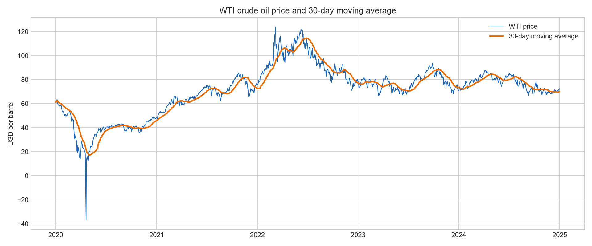
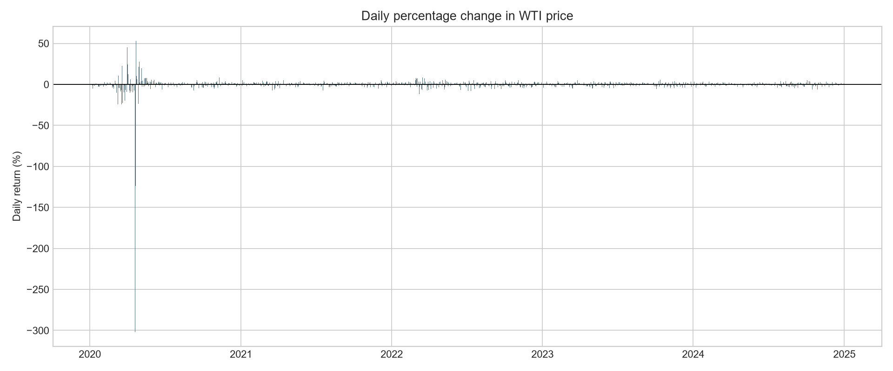
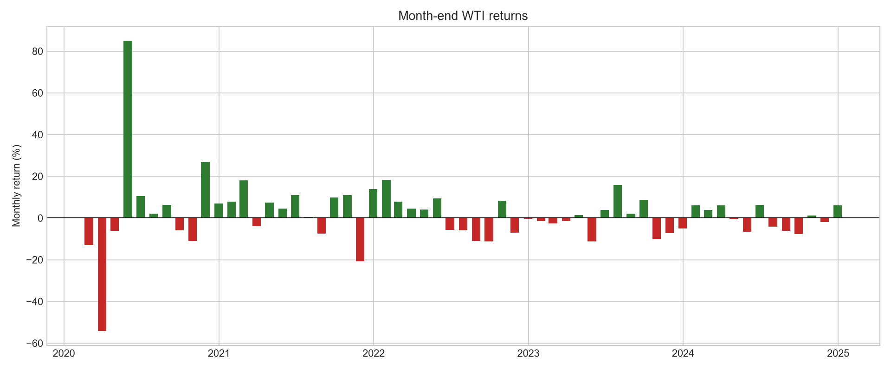

# WTI 원유 가격 시계열 분석

2020~2024년 WTI 원유 가격을 분석해 가격 추세, 급격한 충격, 월별 변동성의 의미를 해석한 프로젝트입니다.

## 프로젝트 한눈에 보기

- **데이터:** FRED `DCOILWTICO` 일별 WTI 원유 현물 가격
- **분석 기간:** 2020-01-02 ~ 2024-12-31
- **데이터 포인트:** 1,252개
- **분석 기법:** 30일 이동평균, 일별 변화율, 30일 이동 표준편차, 월말 수익률
- **시각화:** 가격 추세·이동평균, 일별 수익률, 월별 수익률

## 그래프 미리보기

### 가격 추세와 30일 이동평균



### 일별 변화율



### 월말 수익률



## 핵심 인사이트

1. 시작 가격과 종료 가격만 비교하면 중간의 큰 국면 변화를 놓치게 됩니다. 분석 기간 중 가격 범위는 약 -36.98달러부터 123.64달러까지였습니다.
2. 2020-04-20에는 약 -301.97%의 극단적 일별 변화가 나타났습니다. 이는 일반적인 현물 가격 변동으로 단순 해석하지 않고, 당시 선물시장 구조와 만기 요인을 함께 확인해야 합니다.
3. 월별 평균 수익률은 약 1.77%였지만 표준편차는 약 15.93%였습니다. 평균적인 상승만으로는 가격 위험을 설명하기 어렵습니다.

상세한 관찰·해석·한계는 [REPORT.md](REPORT.md)에 정리했습니다.

## 폴더 구조

```text
data/
  wti_crude_oil_daily.csv       # FRED에서 받은 원본 데이터
images/
  01_price_and_moving_average.png
  02_daily_returns.png
  03_monthly_returns.png
analyze.py                       # 수집·전처리·분석·시각화 코드
REPORT.md                        # 분석 리포트
requirements.txt                 # Python 의존성
```

## 실행 방법

Python 3.10 이상에서 다음 명령을 실행합니다.

```powershell
python -m pip install -r requirements.txt
python analyze.py
```

첫 실행 시 FRED에서 원본 CSV를 내려받아 `data/`에 저장하고, 이후에는 저장된 데이터를 사용합니다. 실행 결과는 `images/`에 PNG 3개로 생성됩니다.

## 데이터 출처와 라이선스 주의

데이터 출처는 [Federal Reserve Bank of St. Louis FRED](https://fred.stlouisfed.org/series/DCOILWTICO)의 DCOILWTICO 시계열입니다. FRED의 이용약관과 원자료 제공기관의 조건을 확인한 뒤 재배포해야 하며, 이 저장소의 분석 코드는 교육 목적입니다.
